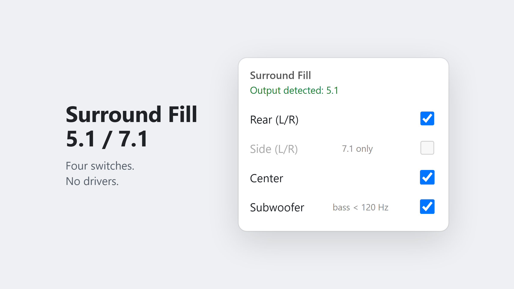

# Surround Fill 5.1 / 7.1

A Chrome/Edge extension that copies the browser's stereo audio to the other channels of a 5.1 or 7.1 speaker system: rear, side (7.1), center and subwoofer. It works inside the page with the Web Audio API: no drivers, no software to install, no added latency.

## What it does

- **Rear**: front left → rear left, front right → rear right
- **Side** (7.1 only): front left → side left, front right → side right
- **Center**: (left + right) / 2 → center
- **Subwoofer**: (left + right) / 2, only the bass below 120 Hz → LFE
- Detects whether the output is 5.1 or 7.1 and shows it in the popup
- Four independent switches; the badge on the icon shows what is on (`R` rear, `S` side, `C` center, `B` bass/subwoofer, and combinations)
- Works on any site with regular video/audio (YouTube, Twitch, Vimeo, news sites…)

## Limitations

- **DRM sites** (Netflix, Prime Video, Disney+, Spotify): the browser does not allow their audio to be processed. The extension detects them and leaves them in normal stereo.
- Audio/video files served from other domains without CORS are skipped for the same reason.
- **Sites with their own Web Audio processing** (visualizers, built-in volume boost or EQ): a media element can only be connected to Web Audio once. If the site gets there first, the extension skips that element. If the extension gets there first, the site's own audio feature may stop working: switch the extension off and reload the page.
- Windows must be set to **5.1 or 7.1** (Control Panel → Sound → Configure), otherwise the browser only sees 2 channels. After changing the configuration, restart the browser.
- After the first activation, that video's audio stays routed through the extension even when it is switched off (as normal stereo). Reloading the page restores everything.

- If your amplifier or driver already does bass management, enabling the subwoofer here can double the bass: in that case leave it off.

## Installation

1. On this page click **Code → Download ZIP** and extract it to a folder you will keep (or clone the repository).
2. Open `chrome://extensions` (Edge: `edge://extensions`) and turn on **Developer mode**.
3. **Load unpacked** → select the **`extension/`** folder inside it, not the top-level folder (otherwise the browser reports a missing manifest).
4. Pin the icon to the toolbar.

## Troubleshooting

- Video muted after activation → click once on the page (the browser may keep audio suspended until you interact with it).
- Added channels silent → F12 → Console, look for lines starting with `[Surround Fill]`.

## Alternatives

There are more complete extensions that upmix stereo → surround, for example *Audio Booster: Real Surround, EQ & Spatial Sound* (Chrome) and *Stereo to 7.1 Surround Upmixer* (Firefox). This one is deliberately minimal: direct channel copy, four switches, no processing beyond the subwoofer filter.

## License

MIT
